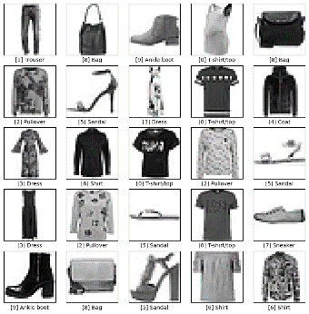
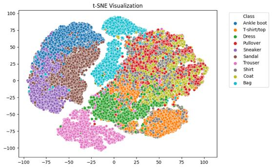
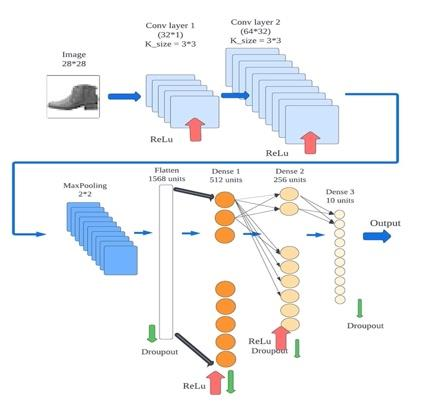
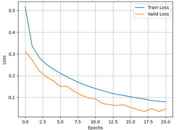
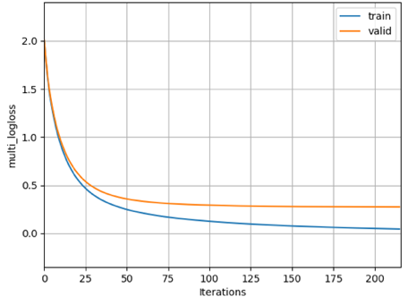
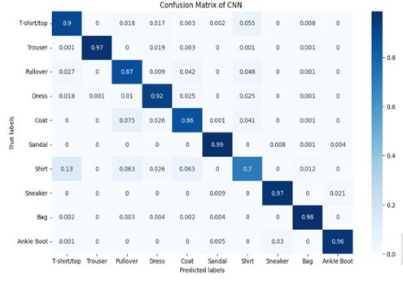
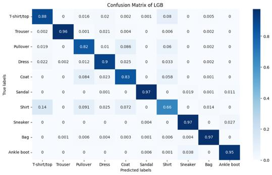
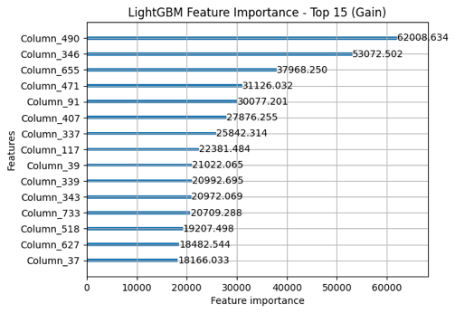
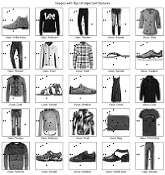

# Fashion-MNIST Model Comparison

**A head-to-head comparison of a convolutional neural network and LightGBM for clothing-image classification, weighing accuracy against training cost.**

**Authors:** Yu-Sheng Chen, Emily Chang, Jen Li Kao

<div align="center">
<table>
  <tr>
    <th>Sample images</th>
    <th>t-SNE of raw pixels</th>
  </tr>
  <tr>
    <td align="center"></td>
    <td align="center"></td>
  </tr>
</table>
</div>

---

## Table of contents

1. [Overview](#overview)
2. [Goals](#goals)
3. [Dataset and preparation](#dataset-and-preparation)
4. [Exploratory analysis](#exploratory-analysis)
5. [Models](#models)
6. [Results](#results)
7. [Insights](#insights)
8. [Limitations and future work](#limitations-and-future-work)
9. [Getting started](#getting-started)
10. [Repository structure](#repository-structure)

---

## Overview

Choosing the right model matters as much as tuning it. This project compares two very different approaches on the same image-classification task: a **convolutional neural network (CNN)**, which learns spatial features directly from pixels, and **LightGBM**, a gradient-boosted decision-tree model that treats each pixel as an independent tabular feature.

**Key outcomes**

- CNN reached **92.25 %** accuracy on the held-out split; LightGBM reached **89.26 %** on the test set
- LightGBM trained **2.6× faster** (446 s vs. 1176 s)
- Both models confuse the same classes: **Shirt**, **Coat**, and **Pullover**
- LightGBM's most important pixels are the ones that separate footwear from clothing

Project write-up on Medium: [Comparison of CNN and LightGBM with Fashion-MNIST](https://medium.com/@emilyjyc/comparison-of-cnn-and-light-gbm-with-fashion-mnist-77cd1644810e)

---

## Goals

| # | Question | How we answer it |
| --- | --- | --- |
| 1 | Which model classifies clothing images more accurately? | Accuracy, precision, recall, and F1 per class |
| 2 | What does each model cost to train? | Wall-clock training time |
| 3 | Where do the models fail? | Confusion matrices |
| 4 | What does a tree model "look at" in an image? | LightGBM feature importance mapped back to pixels |

---

## Dataset and preparation

[Fashion-MNIST](https://github.com/zalandoresearch/fashion-mnist) contains 70,000 grayscale 28 × 28 images in 10 balanced clothing classes.

| Split | Images | Use |
| --- | --- | --- |
| Training | 42,000 | Model fitting (70 % of the original training set) |
| Validation | 18,000 | Early stopping and model selection (30 %) |
| Test | 10,000 | Final evaluation |

Pixel values are scaled to [0, 1]. The CNN receives 1 × 28 × 28 tensors; LightGBM receives each image flattened into 784 pixel features.

---

## Exploratory analysis

Class counts are balanced across all splits (~4,200 per class in training, ~1,800 in validation, 1,000 in test). A **t-SNE** projection of the raw pixels already separates footwear and bags from garments, while upper-body garments (T-shirt, Shirt, Pullover, Coat) overlap heavily, previewing where both models struggle (see the figure at the top).

---

## Models

### Convolutional neural network (PyTorch)

| Component | Configuration |
| --- | --- |
| Convolution | 2 layers (1 → 16 → 32 channels, 3 × 3 kernels), each with ReLU and 2 × 2 max pooling |
| Classifier | Fully connected 1568 → 512 → 256 → 10, dropout 0.2 |
| Initialization | Linear weights drawn from N(0, 1/√n), biases zero |
| Training | Adam (lr 0.001), cross-entropy loss, batch size 32, up to 50 epochs |
| Regularization | Dropout and early stopping (patience 5) |

### LightGBM

| Parameter | Value |
| --- | --- |
| Boosting / objective | GBDT, multiclass (10 classes) |
| Leaves per tree | 31 |
| Learning rate | 0.05 |
| Feature fraction | 0.9 |
| Bagging fraction / frequency | 0.8 / 5 |
| Early stopping | 5 rounds (best iteration: 211) |

LightGBM speeds up boosting with **gradient-based one-side sampling** (keeping high-gradient samples) and **exclusive feature bundling** (merging sparse, mutually exclusive features). No grid or random search was run due to time and compute limits.

<p align="center">
  
  <br>
  <em>CNN architecture.</em>
</p>

<div align="center">
<table>
  <tr>
    <th>CNN training / validation loss</th>
    <th>LightGBM training / validation log-loss</th>
  </tr>
  <tr>
    <td align="center"></td>
    <td align="center"></td>
  </tr>
</table>
</div>

---

## Results

| Metric | CNN | LightGBM |
| --- | --- | --- |
| Accuracy | **92.25 %** (validation split) · 91 % (test set) | 89.26 % (test set) |
| Training time | 1176 s | **446 s** |

The CNN is about 3 percentage points more accurate; LightGBM trains 730 s faster.

### Confusion matrices

Both models are near-perfect on Trouser, Bag, Sandal, and footwear, and both struggle with **Shirt**, which is most often mistaken for T-shirt, Coat, or Pullover because of their similar silhouettes.

<div align="center">
<table>
  <tr>
    <th>CNN</th>
    <th>LightGBM</th>
  </tr>
  <tr>
    <td align="center"></td>
    <td align="center"></td>
  </tr>
</table>
</div>

### What LightGBM looks at

The top-gain pixels (490, 346, 655, …) sit where shoes and garments differ in outline, so the tree model relies mainly on coarse shape cues rather than texture.

<div align="center">
<table>
  <tr>
    <th>Top-15 features by gain</th>
    <th>Top-10 pixels on sample images</th>
  </tr>
  <tr>
    <td align="center"></td>
    <td align="center"></td>
  </tr>
</table>
</div>

---

## Insights

- **Spatial structure matters.** The CNN's convolutions exploit neighboring-pixel patterns, which a pixel-as-feature tree model cannot.
- **Speed is LightGBM's strength.** For frequent retraining, such as rapidly changing product catalogs, its lower training cost can outweigh a few points of accuracy.
- **Some errors are in the data.** Shirt, Coat, and Pullover look alike at 28 × 28; both models fail on the same classes regardless of architecture.

---

## Limitations and future work

- **Evaluation splits differ.** The 92.25 % CNN figure is measured on the 18,000-image validation split, and the CNN's early-stopping loader in the notebook reads the training split; the LightGBM figure uses the 10,000-image test set. Evaluating both models on the same test set would make the comparison stricter.
- **No hyperparameter search.** Grid or random search could narrow the gap for either model.
- **Hybrid models.** Using CNN features as LightGBM inputs could combine accuracy with fast training.

---

## Getting started

Open [`Project.ipynb`](Project.ipynb) in [Google Colab](https://colab.research.google.com/) or Jupyter (a GPU is recommended for the CNN) and run the cells in order. Required packages:

```bash
pip install numpy matplotlib seaborn scikit-learn tensorflow torch torchvision lightgbm pandas
```

TensorFlow is used only to download the dataset.

---

## Repository structure

```
.
├── Project.ipynb        # Data preparation, EDA, CNN, and LightGBM experiments
├── Project Report.pdf   # Full project report
├── images/              # README figures
└── README.md
```

## Acknowledgements

Developed in the Data Mining and Analysis course at Texas A&M University (Fall 2023).
